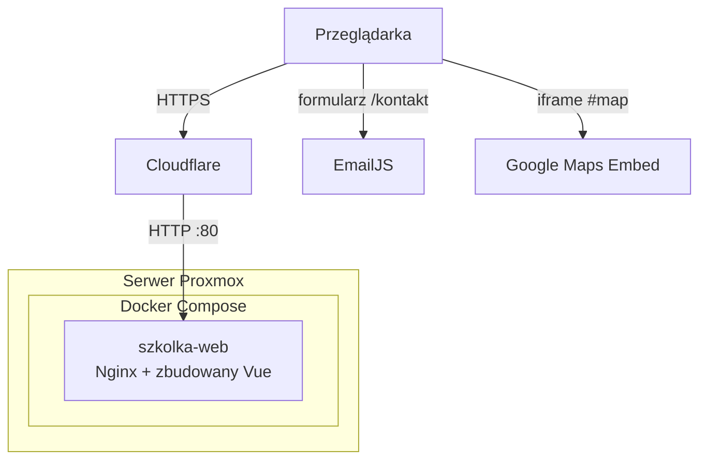

# Strona internetowa szkółki roślin — Szkółka Stramnica

Responsywna aplikacja SPA (**Vue 3** + **Vite**) dla gospodarstwa szkółkarskiego w Stramnicy koło Kołobrzegu — wizytówka z ofertą, galerią, mapą i kontaktem.

**Aplikacja online:** [https://szkolka-stramnica.mkuzownik.tech/](https://szkolka-stramnica.mkuzownik.tech/)

---

## Spis treści

- [Opis projektu](#opis-projektu)
- [Funkcjonalności](#funkcjonalności)
- [Optymalizacja](#optymalizacja)
- [Technologie](#technologie)
- [Hosting](#hosting)
- [Struktura projektu](#struktura-projektu)
- [Architektura](#architektura)

---

## Opis projektu

Czysty frontend bez własnego backendu. Strona pokazuje historię i ofertę szkółki, galerię zdjęć oraz ułatwia kontakt — telefon, formularz (**EmailJS**) i lokalizacja (**Google Maps Embed**).

---

## Funkcjonalności

- **Strona główna** — Hero (karuzela Swiper), O nas, Oferta, Galeria, mapa Google
- **Galeria ze lightboxem** — siatka zdjęć; podgląd pełnoekranowy ze strzałkami i Escape
- **Status otwarcia na żywo** — wskaźnik „otwarte / zamknięte” na podstawie godzin pracy i świąt
- **Formularz kontaktowy** — wysyłka wiadomości przez EmailJS (bez własnego API)
- **Nawigacja SPA** — Vue Router, sticky navbar, menu hamburger na mobile
- **Responsywny design** — pełne dopasowanie do telefonów, tabletów i desktopów
- **Integracje zewnętrzne** — Google Maps, Facebook

| Ścieżka | Opis |
|---------|------|
| `/` | Strona główna |
| `/kontakt` | Formularz i dane kontaktowe |
| `/*` | Strona 404 |

---

## Optymalizacja

Wydajność jest weryfikowana m.in. w **[WebPageTest](https://www.webpagetest.org/)** (waterfall, LCP, rozmiar transferu, cache) oraz uzupełniająco w **PageSpeed Insights** / **Lighthouse** (Core Web Vitals, audyty zasobów). Poniżej decyzje techniczne powiązane z tymi pomiarami.

### LCP i pierwszy ekran

- **Preload obrazu hero** — w `index.html` osobne `link rel="preload"` dla slajdu mobilnego i desktopowego (`media`, `fetchpriority="high"`), żeby element LCP nie czekał w kolejce za JS/CSS.
- **Osobne pliki hero** — `slide*-mobile.webp` vs pełnowymiarowe slajdy; mniejszy transfer na telefonach bez obciążania desktopu.
- **Logo i ikony** — WebP / inline SVG zamiast ciężkich bitmap tam, gdzie to możliwe.

### Mniejszy transfer i krótszy waterfall

- **WebP** — galeria i hero w formacie WebP.
- **Miniatury vs pełne zdjęcia** — siatka galerii i siatka w trzecim slajdzie hero korzystają z `assets/photos_gallery/thumbs/`; katalog `full/` ładuje się na żądanie (lightbox, hover / prefetch sąsiadów).
- **`import.meta.glob`** — lazy import miniatur i pełnych plików galerii; pełna paczka zdjęć nie trafia do początkowego bundla JS.
- **Lazy-loading** — `loading="lazy"` i `decoding="async"` na obrazach poniżej pierwszego widoku (galeria, sekcja O nas).
- **Ładowanie „na widok”** — `IntersectionObserver` dla miniatur galerii (dopiero przy zbliżeniu do sekcji) oraz dla iframe mapy Google (embed nie startuje od razu po wejściu na stronę).
- **Trzeci slajd hero** — miniatury siatki ładują się po przejściu na slajd z galerią, nie przy starcie aplikacji.

### Interakcja i galeria

- **Prefetch w lightboxie** — po otwarciu podglądu i przy najechaniu na kafelki doładowywane są sąsiednie pełne zdjęcia; przed pokazaniem używane jest `Image.decode()`, żeby ograniczyć migotanie i przesunięcia layoutu.
- **Animacja Ken Burns** — tylko od szerokości ≥1025px, bez dodatkowej pracy GPU na mobile w pierwszym widoku.

### Cache i dostarczanie (produkcja)

- **Vite** — pliki w `dist/assets/` z hashem w nazwie.
- **Nginx** — `gzip` dla tekstu/JS/CSS/SVG; `Cache-Control: public, immutable` na rok dla `/assets/`, `no-cache` dla `index.html`, żeby nowe buildy były widoczne od razu przy długim cache zasobów statycznych.

### SPA i nawigacja

- **`history.scrollRestoration = 'manual'`** — przewidywalne zachowanie scrolla przy odświeżeniu i routingu w SPA (mniej „skoków” po wejściu na stronę główną).
- **EmailJS** — używany na trasie `/kontakt`, nie na stronie głównej.

---

## Technologie

| Warstwa | Stack |
|---------|--------|
| Frontend | Vue 3, Vue Router 4, Vite 8 |
| UI / media | Swiper, WebP, inline SVG |
| Integracje | EmailJS, Google Maps Embed |
| Produkcja | Docker (multi-stage), Nginx, Docker Compose |

---

## Hosting

Własny serwer **Proxmox**, kontener **Docker** (Nginx + statyczny build SPA), orkiestracja **Docker Compose**.

```
Internet → Proxmox → Docker (Nginx :80) → dist/
```

---

## Struktura projektu

<details>
<summary>Rozwiń pełną strukturę katalogów</summary>

```
Szkolka_Stramnica/
├── docker-compose.yml
├── README.md
└── szkolka-stramnica/
    ├── Dockerfile              # Node build → Nginx
    ├── nginx.conf
    ├── package.json
    ├── vite.config.js
    ├── index.html
    ├── public/
    └── src/
        ├── main.js
        ├── App.vue             # Navbar + router-view
        ├── router/index.js
        ├── views/
        │   ├── HomeView.vue
        │   ├── Kontakt.vue
        │   ├── Katalog.vue     # wyłączony w routerze
        │   └── NotFound.vue
        ├── components/
        │   ├── Navbar.vue
        │   ├── Hero.vue
        │   ├── Opis.vue
        │   ├── Oferta.vue
        │   ├── Galeria.vue
        │   └── GoogleMap.vue
        └── assets/
            ├── icons/              # SVG oferty (np. trawy, krzewy)
            ├── photos_gallery/     # pełne WebP + thumbs/
            └── photos_catalog/
```

</details>

---

## Architektura

### Przepływ żądania



Strona nie ma własnego API — po załadowaniu SPA cała logika UI działa w przeglądarce; formularz i mapa wołają usługi zewnętrzne bezpośrednio z klienta.

### Warstwy kodu

| Część | Rola |
|-------|------|
| `App.vue` | Layout: navbar, opakowanie treści (`router-view`) |
| `router/index.js` | Trasy SPA, strona 404 |
| `views/` | Widoki pełnoekranowe (`HomeView`, `Kontakt`, `NotFound`) |
| `components/` | Sekcje strony głównej (Hero, Opis, Oferta, Galeria, mapa, navbar) |
| `assets/` | WebP (hero, galeria), logo, ikony SVG oferty |

### Routing

| Ścieżka | Widok | Zawartość |
|---------|--------|-----------|
| `/` | `HomeView.vue` | Hero (Swiper), O nas, Oferta, Galeria, `GoogleMap` |
| `/kontakt` | `Kontakt.vue` | Dane kontaktowe, formularz → EmailJS |
| `/*` | `NotFound.vue` | Strona błędu 404 |

Kotwice na stronie głównej (`#opis`, `#oferta`, `#galeria`, `#map`) obsługiwane w navbarze bez osobnych tras.

### Frontend

- Jednostronicowa aplikacja **Vue 3** (Composition API), bundlowana przez **Vite**
- **Vue Router** — historia przeglądarki, `scrollRestoration: manual` w `main.js`
- Galeria: miniatury z `import.meta.glob`, pełne zdjęcia i lightbox na żądanie; `IntersectionObserver` przed załadowaniem siatki
- Hero: osobne assety mobilne/desktopowe, preload pierwszego slajdu w `index.html`
- Formularz kontaktowy: `@emailjs/browser` (identyfikatory z build args `VITE_EMAILJS_*`)

### Wdrożenie

```
Internet → Cloudflare (HTTPS) → Proxmox → Docker Compose
                                              └── szkolka-web  Nginx :80
```

Kontener budowany z `szkolka-stramnica/Dockerfile`: etap **Node 20** (`npm run build`), etap **nginx:alpine** z `dist/` i `nginx.conf` (`gzip`, cache dla `/assets/`, `try_files` pod SPA). Zmienne EmailJS przekazywane jako `build.args` w `docker-compose.yml`.
